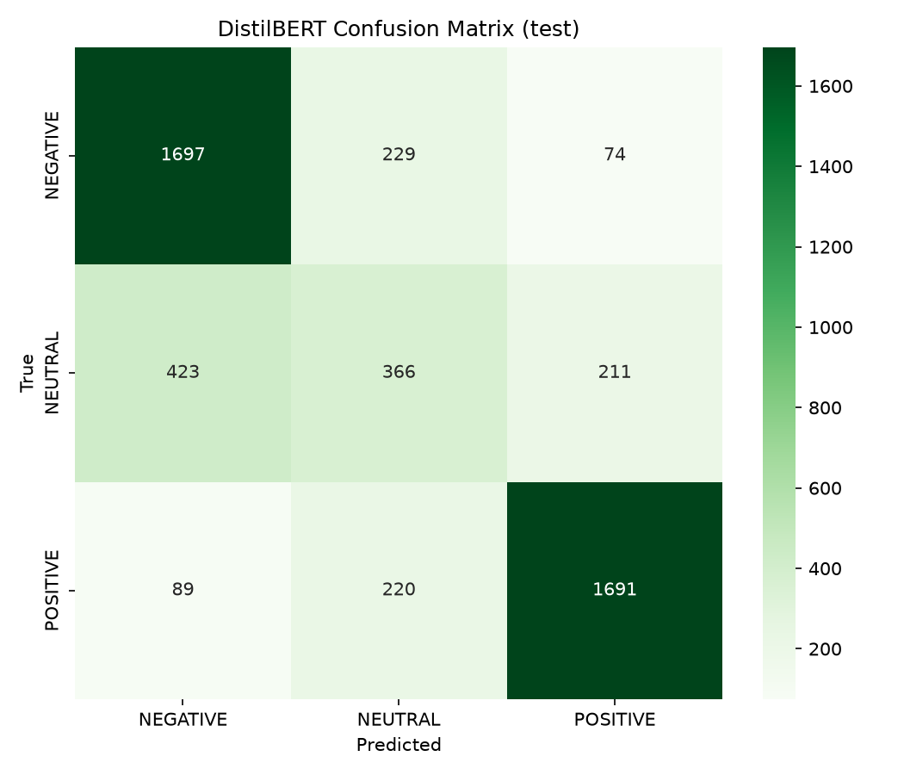

# Sentiment Analysis — App Reviews

Klasifikasi sentimen review aplikasi menjadi **POSITIVE / NEUTRAL / NEGATIVE** menggunakan DistilBERT yang di-fine-tune pada dataset Amazon Reviews.

**🔗 Live Demo & Laporan Lengkap:** https://kusjay-space.github.io/sentiment-analysis

> Submission untuk AI Engineer Intern assessment — Timedoor.
> Semua angka di dokumen ini berasal dari run aktual (`results/metrics.json`, `results/metrics_baseline_tuned.json`, `results/real_world_test.json`), bukan estimasi.

---

## Ringkasan Hasil

| Model | Data training | Split evaluasi | Accuracy | F1-macro |
|---|---|---|---|---|
| Baseline — TF-IDF + Logistic Regression | 60.000 | validation | 70.2% | 0.674 |
| **DistilBERT (model utama)** | **30.000** | **test** | **75.1%** | **0.687** |

**Poin penting:** DistilBERT menang **+4.9 poin accuracy** meskipun hanya dilatih pada **separuh** data baseline (30k vs 60k). Ini menunjukkan keunggulan pemahaman konteks dibanding pendekatan bag-of-words.

**Validasi di data nyata** (review Play Store, di luar dataset training):

| Test | n | Accuracy | Confidence < 0.5 |
|---|---|---|---|
| Test set akademik (Amazon) | 5.000 | 75.1% | — |
| **Real-world English** (Play Store US) | 67 | **74.6%** | 10% |
| Real-world Indonesian (Play Store ID) | 80 | 57.5% | **69%** |

Selisih hanya **0.5 poin** antara test set akademik dan review Inggris asli → model belajar sinyal sentimen, bukan menghafal dataset.

---

## Deliverables

| Yang diminta brief | Status | Lokasi |
|---|---|---|
| Dataset open-source | ✅ | [HuggingFace `SetFit/amazon_reviews_multi_en`](https://huggingface.co/datasets/SetFit/amazon_reviews_multi_en) |
| Pre-trained / fine-tuned model | ✅ | `model/final/` · [Releases v1.0](https://github.com/kusjay-space/sentiment-analysis/releases) |
| Kode clean & terdokumentasi | ✅ | `src/` (7 modul, semua ber-docstring) |
| Inference 5–10 unseen samples | ✅ | `results/predictions.csv` (10 sampel, 8/10 benar) |
| DataFrame: text + sentiment + confidence | ✅ | `results/predictions.csv` |
| Repo GitHub publik | ✅ | https://github.com/kusjay-space/sentiment-analysis |
| README + cara instalasi | ✅ | dokumen ini |
| GitHub Pages: model, dataset, hasil | ✅ | https://kusjay-space.github.io/sentiment-analysis |

---

## Dataset

**Sumber:** [`SetFit/amazon_reviews_multi_en`](https://huggingface.co/datasets/SetFit/amazon_reviews_multi_en) — review produk berbahasa Inggris dengan rating bintang 1–5. HuggingFace adalah salah satu platform yang direkomendasikan brief (selain Kaggle dan Roboflow).

**Split yang dipakai:**

| Split | Jumlah | Fungsi |
|---|---|---|
| Train | **30.000** | melatih DistilBERT (subsample stratified 12k NEG / 6k NEU / 12k POS, seed 42) |
| Validation | 5.000 | seleksi model & hyperparameter |
| Test | 5.000 | angka final — **disentuh tepat sekali** |

**Mapping label** — 5 bintang digabung menjadi 3 kelas:

| Bintang asli | Kelas sentimen |
|---|---|
| ★☆☆☆☆ · ★★☆☆☆ | NEGATIVE |
| ★★★☆☆ | NEUTRAL |
| ★★★★☆ · ★★★★★ | POSITIVE |

Hanya bintang 3 yang menjadi NEUTRAL, sementara NEGATIVE dan POSITIVE masing-masing mendapat dua bintang. Karena itu **NEUTRAL selalu jadi kelas minoritas (20%)** — dan inilah sumber utama kesulitan model.

**Distribusi kelas pada data training:**

| Kelas | Jumlah | Proporsi |
|---|---|---|
| NEGATIVE | 12.000 | 40% |
| NEUTRAL | 6.000 | 20% |
| POSITIVE | 12.000 | 40% |
| **Total** | **30.000** | 100% |

Karena NEUTRAL minoritas, baseline memakai `class_weight='balanced'` dan F1 dilaporkan per kelas.

**Karakteristik teks:** median 23 kata (p95 = 88, maks 429) · 98.3% review ≤ 128 kata sehingga `max_len=128` memadai · kolom `id`, `text`, `label`, `label_text`.

---

## Pendekatan

Pipeline dikerjakan bertahap — baseline dulu untuk mengukur batas pendekatan klasik, lalu fine-tuning untuk melampauinya.

**1. Data preparation** (`src/preprocess.py`)
Load dataset, mapping 5 bintang → 3 kelas, EDA (distribusi label, panjang teks, sampel per kelas), lalu stratified subsample dengan seed 42.

**2. Baseline** (`src/baseline.py`, `src/baseline_tuned.py`)
TF-IDF (sublinear TF, 100k fitur, bigram) + Logistic Regression dengan `class_weight='balanced'`. Empat konfigurasi hyperparameter disapu, ditambah sweep tambahan (trigram, char n-gram, 510k fitur, variasi C).

**3. Fine-tuning** (`src/train.py`)
DistilBERT base uncased · 2 epoch · batch 32 · lr 2e-5 · max_len 128 · fp16 (GPU T4) · AdamW · `load_best_model_at_end` berdasarkan F1-macro validation.

**4. Disiplin split (anti-leakage)**
Seleksi model dan hyperparameter **hanya** di validation. Test disentuh **tepat sekali** untuk angka final. `train.py` tidak pernah memuat split test.

**5. Evaluasi** (`src/inference.py`)
Accuracy, F1-macro, F1-weighted, F1 per kelas, dan confusion matrix. F1-macro jadi metrik pendamping utama karena kelas tidak seimbang.

**6. Inference** (`src/predict.py`, `src/analyze.py`)
10 sampel unseen dari test split, plus tool untuk menganalisis teks/file milik pengguna sendiri.

**7. Validasi data nyata**
Scraping review asli Play Store (Inggris & Indonesia) untuk menguji generalisasi di luar distribusi training.

---

## Hasil

### DistilBERT — test split (5.000 sampel)

| Metrik | Nilai |
|---|---|
| Accuracy | **75.1%** |
| F1-macro | **0.687** |
| F1-weighted | 0.743 |

**F1 per kelas:**

| Kelas | F1 | Interpretasi |
|---|---|---|
| NEGATIVE | 0.806 | kuat — sinyal negatif umumnya eksplisit |
| NEUTRAL | 0.403 | **terlemah** — bintang 3 ambigu secara linguistik dan kelas minoritas |
| POSITIVE | 0.851 | terkuat — pujian cenderung jelas |



Kesalahan terbesar terjadi pada kelas NEUTRAL yang tersebar ke NEGATIVE dan POSITIVE — konsisten dengan sifat ambigunya rating bintang 3.

### Kenapa baseline mentok di ~70%

Sweep hyperparameter TF-IDF + LogReg (60.000 sampel training) menunjukkan ceiling ≈70.2%: bigram, trigram, char n-gram, 510k fitur, dan variasi nilai C semuanya **< 71%**. Bottleneck-nya kelas NEUTRAL (F1 0.468) — bintang 3 secara inheren ambigu, dan TF-IDF tidak menangkap konteks kalimat seperti "bagus tapi mahal". Inilah motivasi utama fine-tuning.

### DistilBERT vs ekspektasi awal

Target awal 85% **tidak tercapai** (realisasi 75.1%). Penyebab yang bisa diidentifikasi:

1. **Training hanya 2 epoch pada 30k sampel** — model kontekstual butuh lebih banyak data/epoch untuk menangkap nuansa NEUTRAL.
2. **NEUTRAL ambigu secara inheren** — bahkan DistilBERT hanya mencapai F1 0.40 di kelas ini.

Meski begitu DistilBERT tetap unggul **+4.9 poin accuracy** atas baseline dan jauh lebih baik di NEGATIVE/POSITIVE (0.81 / 0.85). Perbaikan lanjutan yang masuk akal: tambah data training, 3–4 epoch, atau focal loss untuk kelas minoritas.

### Validasi di data nyata

Test set akademik bisa menipu — model berpotensi menghafal pola dataset. Karena itu model diuji pada **review asli hasil scraping Play Store** menggunakan `google-play-scraper`, di luar distribusi training. Ground truth = star rating dengan mapping yang sama seperti training.

| Test | Data | n | Accuracy | F1-macro | Conf < 0.5 |
|---|---|---|---|---|---|
| Test set akademik | Amazon Reviews (test split) | 5.000 | 75.1% | 0.687 | — |
| **Real-world English** | Play Store US (Spotify, Instagram) | 67 | **74.6%** | 0.593 | 10% |
| **Real-world Indonesian** | Play Store ID (Gojek, Tokopedia) | 80 | 57.5% | 0.364 | **69%** |

**Empat temuan:**

1. **Bahasa Inggris ter-generalisasi.** Selisih 75.1% (akademik) vs 74.6% (nyata) hanya **0.5 poin** — bukti model tidak overfit.
2. **Bahasa Indonesia di luar domain.** Model dilatih hanya pada teks Inggris; tokenizer memecah kata Indonesia menjadi 2–4 subword tanpa makna (`mengecewakan` → `meng` / `##ece` / `##wa` / `##kan`). Akurasi turun ke 57.5% dengan bias ke NEGATIVE (60 dari 80 prediksi).
3. **Model menandai ketidakpastiannya.** Di data Indonesia, **69% prediksi ber-confidence < 0.5**, versus hanya 10% di data Inggris. Model tidak salah tebak dengan yakin — perilaku yang justru diinginkan di produksi, karena prediksi low-confidence bisa di-flag untuk review manusia.
4. **Noise di data nyata.** Sebagian review Play Store US ternyata berbahasa Portugis, dan sebagian label bintang tidak konsisten dengan teksnya (teks negatif diberi 5 bintang). Ceiling akurasi pada data nyata memang lebih rendah dari benchmark akademik.

Bukti per sampel: [`results/real_world_test.json`](results/real_world_test.json).

### 10 sampel unseen (8/10 benar)

| Text | True | Predicted | Confidence |
|---|---|---|---|
| Stopped working after a couple of weeks... | NEGATIVE | NEGATIVE | 0.971 |
| I have not yet got my order!!! | NEGATIVE | NEGATIVE | 0.515 |
| I had gotten these for a family member... | NEUTRAL | NEGATIVE ❌ | 0.707 |
| The presentation is great, but the flavor is ordinary... | NEUTRAL | NEUTRAL | 0.588 |
| Surprisingly ineffective product... | NEGATIVE | NEGATIVE | 0.661 |
| too loosen. cable is easy to dropping | NEGATIVE | NEUTRAL ❌ | 0.586 |
| A lot of the capsules were empty... | NEGATIVE | NEGATIVE | 0.808 |
| My niece love these balls!... | POSITIVE | POSITIVE | 0.981 |
| Ordered this for a Santa present... came broken! | NEGATIVE | NEGATIVE | 0.909 |
| Great product. Very satisfied... | POSITIVE | POSITIVE | 0.991 |

Kedua kesalahan melibatkan kelas NEUTRAL — konsisten dengan F1 NEUTRAL yang paling rendah. Data lengkap: [`results/predictions.csv`](results/predictions.csv).

---

## Instalasi

```bash
git clone https://github.com/kusjay-space/sentiment-analysis.git
cd sentiment-analysis

python -m venv .venv
source .venv/bin/activate          # Windows: .venv\Scripts\activate

pip install -r requirements.txt

# Unduh model checkpoint (~256 MB) dari Releases
gh release download v1.0 -p model_final.zip
unzip model_final.zip -d model/
```

Tanpa `gh` CLI, unduh manual: [Releases v1.0](https://github.com/kusjay-space/sentiment-analysis/releases) → `model_final.zip` → ekstrak ke folder `model/`.

> **Catatan penting:** jalankan semua perintah dengan Python dari virtualenv proyek. Kalau muncul `ModuleNotFoundError: No module named 'torch'`, berarti venv belum aktif — pakai `./run.sh` (lihat di bawah) atau `source .venv/bin/activate` dulu.

---

## Cara Pakai

Ada **tiga cara** menjalankan, pilih yang paling nyaman:

```bash
# 1. Wrapper (paling mudah — otomatis pakai venv, tanpa activate)
./run.sh predict "This product is amazing"
./run.sh analyze reviews.csv

# 2. Aktifkan venv dulu
source .venv/bin/activate
python -m src.predict "This product is amazing"
python -m src.analyze reviews.csv

# 3. Panggil venv python langsung
.venv/bin/python -m src.predict "This product is amazing"
.venv/bin/python -m src.analyze reviews.csv
```

### A. Satu teks (prediksi cepat)

```bash
./run.sh predict "This product is amazing, works perfectly"
```

```
  → POSITIVE (conf 0.992)
    NEG 0.002 | NEU 0.005 | POS 0.992
```

Tanpa argumen → mode interaktif (ketik teks → Enter → hasil, `quit` untuk keluar).

### B. Banyak review dari file CSV/Excel

Siapkan file dengan **minimal satu kolom berisi teks review**:

```csv
id,review,rating
1,This app is fantastic. Works perfectly.,5
2,Stopped working after the update. Crashes constantly.,1
3,It's okay. Does the job but nothing special.,3
```

Kolom `rating` **opsional** — kalau ada (skala 1–5 atau 0–4), tool otomatis menghitung akurasi terhadap rating tersebut.

```bash
./run.sh analyze reviews.csv
```

Output di terminal:

```
Reading reviews.csv ...
  3 rows · 3 columns
  text column : review
  rating column: rating

Running inference on 3 reviews (device: cpu) ...

==============================================================
HASIL ANALISIS
==============================================================
  Review dianalisis      : 3
  Rata-rata confidence   : 0.863
  Perlu review manual    : 0 (confidence < 0.5)

  Distribusi sentimen:
    POSITIVE       2  ( 66.7%)  █████████████████████████████████
    NEUTRAL        0  (  0.0%)
    NEGATIVE       1  ( 33.3%)  ████████████████

  Akurasi vs rating asli : 100.00% (3 baris punya rating)
--------------------------------------------------------------
  Output  : results/analyzed_reviews.csv
  Ringkasan: results/analyze_summary.json
--------------------------------------------------------------
```

**Output ditulis ke** `results/analyzed_<namafile>.csv` — berisi seluruh kolom asli ditambah:

| Kolom baru | Isi |
|---|---|
| `sentiment` | `POSITIVE` / `NEUTRAL` / `NEGATIVE` |
| `confidence` | 0–1, keyakinan model pada prediksinya |
| `prob_negative` | probabilitas kelas NEGATIVE |
| `prob_neutral` | probabilitas kelas NEUTRAL |
| `prob_positive` | probabilitas kelas POSITIVE |
| `needs_review` | `True` bila confidence < 0.5 → sebaiknya dicek manusia |

Ringkasan statistik juga disimpan sebagai `results/analyze_summary.json` (machine-readable, termasuk confusion matrix bila kolom rating tersedia).

**Opsi tambahan:**

```bash
./run.sh analyze reviews.csv --text-col komentar   # tentukan kolom teks manual
./run.sh analyze reviews.csv -o hasil/analisis.csv # tentukan lokasi output
./run.sh analyze reviews.xlsx -o hasil.xlsx        # Excel in → Excel out
./run.sh analyze reviews.csv --dry-run             # cek kolom terdeteksi, tanpa model
./run.sh analyze reviews.csv --batch-size 64       # ubah batch size
```

**Kolom terdeteksi otomatis:** `text`, `review`, `review_text`, `content`, `comment`, `komentar`, `ulasan`, `body`, `message`, `feedback`, `deskripsi`. Untuk rating: `rating`, `score`, `stars`, `star`, `bintang`, `label`. Kalau tidak ada yang cocok, tool memilih kolom teks dengan rata-rata panjang terbesar; kalau masih gagal, gunakan `--text-col`.

**Format didukung:** `.csv` (UTF-8/UTF-8-BOM/latin-1; delimiter `,` `;` tab `|` terdeteksi otomatis, termasuk teks yang mengandung koma tanpa quote), `.tsv`, `.xlsx`, `.xls`.

**Kecepatan:** ~6 review/detik di CPU 2 core (147 review = 24 detik). Dengan GPU jauh lebih cepat.

Contoh file input tersedia di [`examples/reviews_sample.csv`](examples/reviews_sample.csv).

### C. Evaluasi ulang pada test set

```bash
./run.sh inference
```

Menghasilkan `results/metrics.json`, `results/predictions.csv`, dan `results/confusion_matrix.png`.

### D. Training ulang

```bash
./run.sh baseline     # baseline TF-IDF + LogReg (CPU, ~5 menit)
./run.sh train        # fine-tune DistilBERT (butuh GPU; gunakan Colab/Kaggle)
```

---

## Model yang Tersedia

**Penting untuk dipahami:** hanya **DistilBERT** yang disimpan sebagai checkpoint dan bisa langsung dipakai.

| Model | Checkpoint tersedia? | Bisa dipakai langsung? | Perannya di project |
|---|---|---|---|
| **DistilBERT** (fine-tuned) | ✅ `model/final/` · 256 MB di [Releases](https://github.com/kusjay-space/sentiment-analysis/releases) | ✅ ya | **model utama** — dipakai `predict.py`, `analyze.py`, `inference.py` |
| TF-IDF + Logistic Regression | ❌ tidak disimpan | ❌ harus training ulang (`./run.sh baseline`) | **baseline pembanding** — untuk mengukur batas pendekatan klasik dan memotivasi fine-tuning |

Baseline sengaja tidak disimpan sebagai artefak karena perannya hanya pembanding: yang perlu dibuktikan adalah *seberapa jauh model kontekstual melampaui pendekatan klasik*, bukan menyediakan model kedua untuk produksi. Metrik dan confusion matrix-nya tetap disimpan sebagai bukti run nyata:

- `results/metrics_baseline_tuned.json` — accuracy 70.2%, F1-macro 0.674, n_train 60.000
- `results/confusion_matrix_baseline_tuned.png`

Kalau kamu ingin baseline-nya bisa dipakai lagi tanpa training, jalankan `./run.sh baseline` lalu tambahkan `joblib.dump(model, ...)` pada `src/baseline.py` — saat ini memang belum ada.

---

## Limitasi

1. **Target 85% tidak tercapai** (realisasi 75.1%). Angka dilaporkan apa adanya, tidak dioptimalkan pada test set.
2. **NEUTRAL adalah bottleneck utama** (F1 0.403). Bintang 3 mencakup review campuran — "bagus tapi mahal" — sehingga batas antar kelas kabur bahkan bagi manusia.
3. **Baseline mentok di ~70.2%.** Sapuan hyperparameter ekstensif mengonfirmasi ceiling pendekatan tanpa konteks.
4. **Hanya bahasa Inggris.** Terbukti dari uji data nyata: 57.5% pada review Indonesia dengan 69% confidence rendah.
5. **Percobaan dengan data lebih banyak tidak dipakai.** Melatih ulang dengan seluruh dataset + 3 epoch + class weight NEUTRAL×2 menaikkan F1 NEUTRAL (0.398 → 0.531) tetapi menurunkan accuracy (74.9% → 71.2%) karena NEGATIVE tergerus. Trade-off tidak menguntungkan, sehingga konfigurasi 30k dipertahankan.
6. **Pemotongan teks.** 1.7% review melebihi 128 token sehingga konteksnya terpotong.
7. **Demo interaktif di browser tidak disediakan.** GitHub Pages bersifat static hosting (tanpa Python), sehingga inferensi dijalankan lokal, bukan di halaman web.

---

## Struktur Repo

```
sentiment-analysis/
├── src/                      # kode utama
│   ├── preprocess.py         # load dataset, mapping label, stratified subsample
│   ├── baseline.py           # TF-IDF + LogisticRegression
│   ├── baseline_tuned.py     # sweep hyperparameter baseline
│   ├── train.py              # fine-tune DistilBERT
│   ├── inference.py          # evaluasi test set → metrics, predictions, confusion matrix
│   ├── predict.py            # prediksi 1 teks / interaktif
│   └── analyze.py            # batch analisis file CSV/Excel milik pengguna
├── notebooks/                # 01_eda, 02_baseline, 03_finetune
├── results/                  # metrics.json, predictions.csv, confusion matrix, real-world test
├── examples/                 # contoh file input (reviews_sample.csv)
├── docs/                     # GitHub Pages (index.html, confusion_matrix.png)
├── model/                    # checkpoint (via Releases, tidak di-commit)
├── run.sh                    # wrapper: jalankan tanpa activate venv
├── requirements.txt          # 11 dependensi, versi ter-pin
└── LICENSE                   # MIT
```

---

## Environment

- Python 3.11
- PyTorch 2.14.1 (CPU untuk inference; GPU T4 untuk training)
- Transformers 5.20.2
- Semua versi di-pin di [`requirements.txt`](requirements.txt)

Model di-fine-tune di Google Colab (GPU T4) menggunakan [`notebooks/03_finetune.ipynb`](notebooks/03_finetune.ipynb), lalu checkpoint dievaluasi ulang secara lokal.

---

## Lisensi

MIT — lihat [LICENSE](LICENSE).
